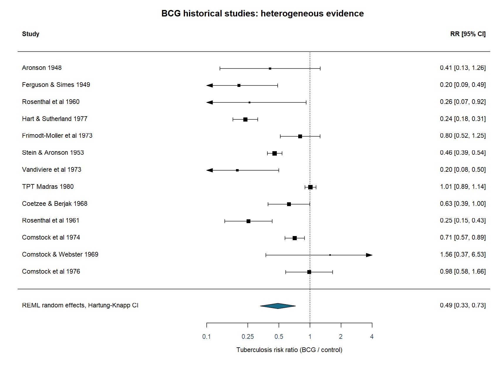
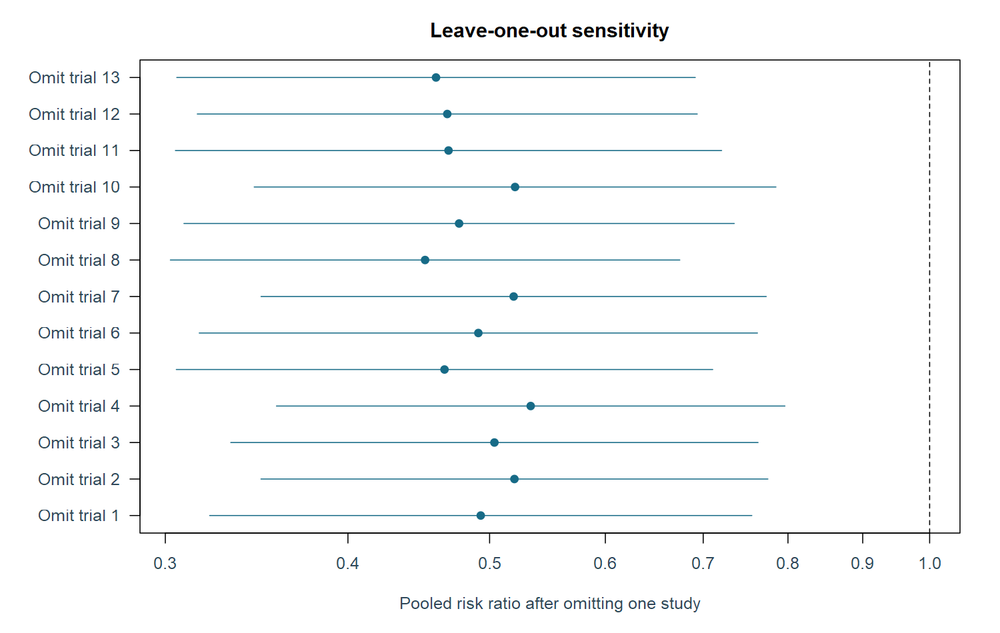
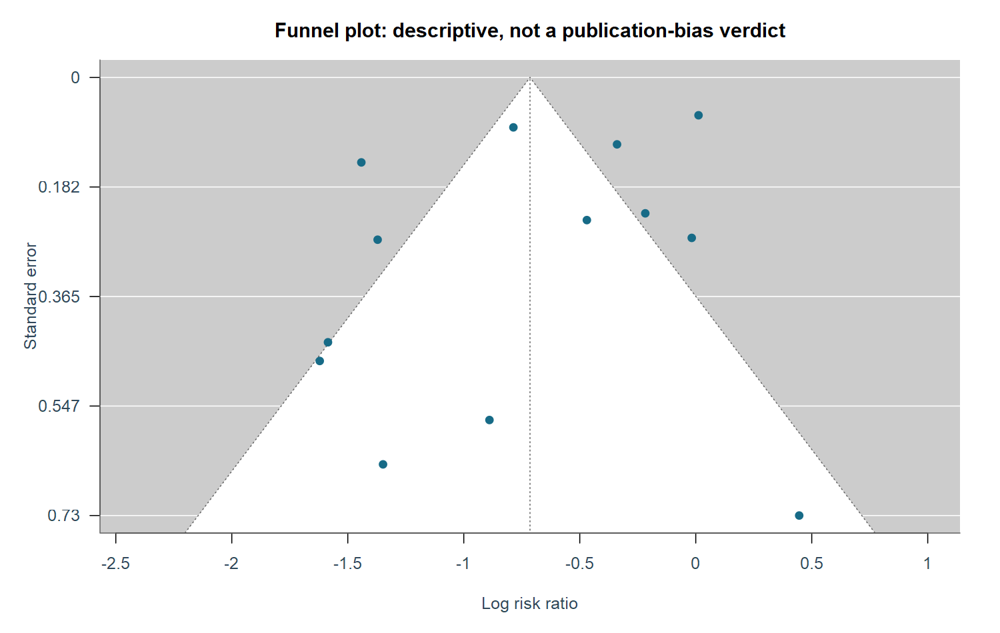

# BCG历史研究：可复现的荟萃分析

对metadat公开汇总的13项研究进行统计复核。不是新完成的系统综述，未独立执行文献检索、双人筛选、全文数据提取或正式偏倚风险评估。

## 1. 研究集和效应定义

13项研究共报告357347个组别参与者计数。结局为各研究随访窗口内结核事件，随访长度与人群不同；计算风险比而非发生率比。所有四格表计数均大于0，本数据不使用连续性校正。部分研究为交替/系统分配，不能统称13项随机对照试验。

| allocation | Freq |
| --- | --- |
| alternate | 2 |
| random | 7 |
| systematic | 4 |

## 2. 随机效应与森林图

先在log(RR)尺度按方差加权，REML估计研究间方差；Hartung-Knapp调整合并均值区间。CI针对平均真实效应，预测区间针对相似研究的真实效应，不是个体治疗效果。异质性明显时，不能把合并RR直接推广到所有地区。

| studies | RR | ci_low | ci_high | prediction_low | prediction_high | tau2 | I2 | Q | Q_p | p |
| --- | --- | --- | --- | --- | --- | --- | --- | --- | --- | --- |
| 13 | 0.48942 | 0.33007 | 0.7257 | 0.13588 | 1.7629 | 0.31324 | 92.221 | 152.23 | 1.9968e-26 | 0.00192 |

## 3. 稳健性检查

同时报告DL方差估计、随机分配研究子集和逐研究剔除。随机分配标签不是完整偏倚风险评级；模型之间的差异不通过挑选显著结果解决。

| analysis | k | RR | ci_low | ci_high | tau2 | I2 |
| --- | --- | --- | --- | --- | --- | --- |
| All studies REML / KH | 13 | 0.48942 | 0.33007 | 0.72570 | 0.31324 | 92.221 |
| All studies DL / KH | 13 | 0.48962 | 0.33028 | 0.72585 | 0.30876 | 92.117 |
| Random allocation subset REML / KH | 7 | 0.37872 | 0.20386 | 0.70357 | 0.39253 | 89.934 |

## 4. 探索性异质性分析

以绝对纬度每10度为单一研究层面协变量。研究层面关联存在生态偏差和混杂，不能据此解释个体生物机制；仅13项研究，探索性结果不等于确证性发现。

| term | log_RR | ci_low | ci_high | p |
| --- | --- | --- | --- | --- |
| Intercept | 0.25146 | -0.37346 | 0.87639 | 0.3947518 |
| Absolute latitude +10 degrees | -0.29102 | -0.47153 | -0.11050 | 0.0045655 |

## 5. 漏斗图与证据限制

漏斗图只作描述，非对称可能来自异质性、研究设计或小样本效应，不能据图断言发表偏倚。该数据是既有历史研究集合，不代表截至2026年的完整最新证据；项目不用于临床疫苗决策。

